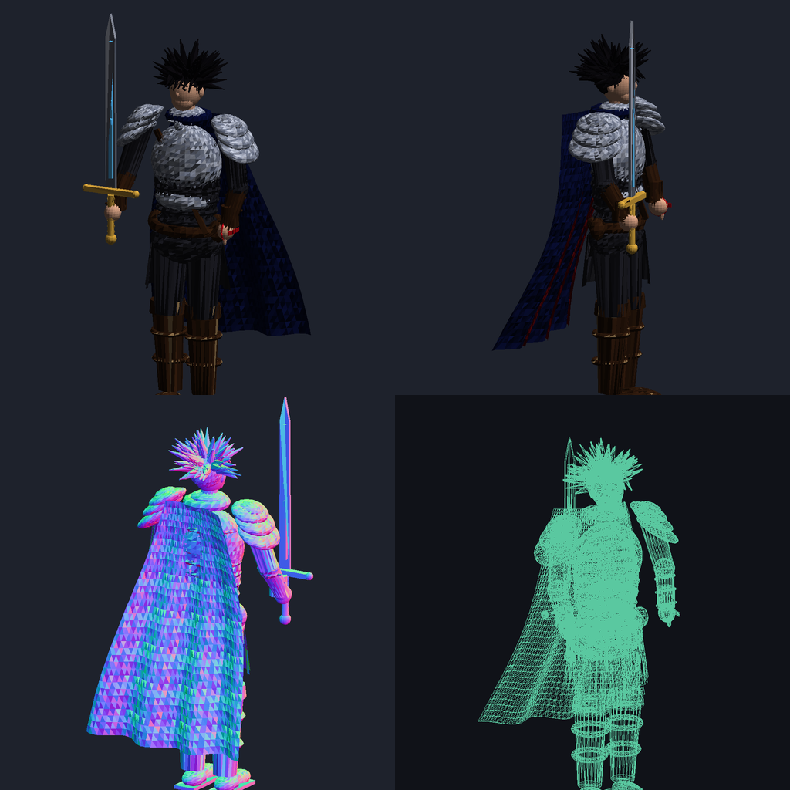
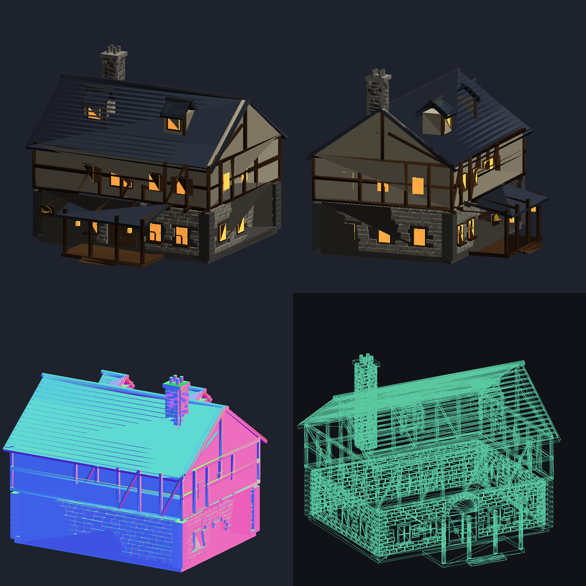
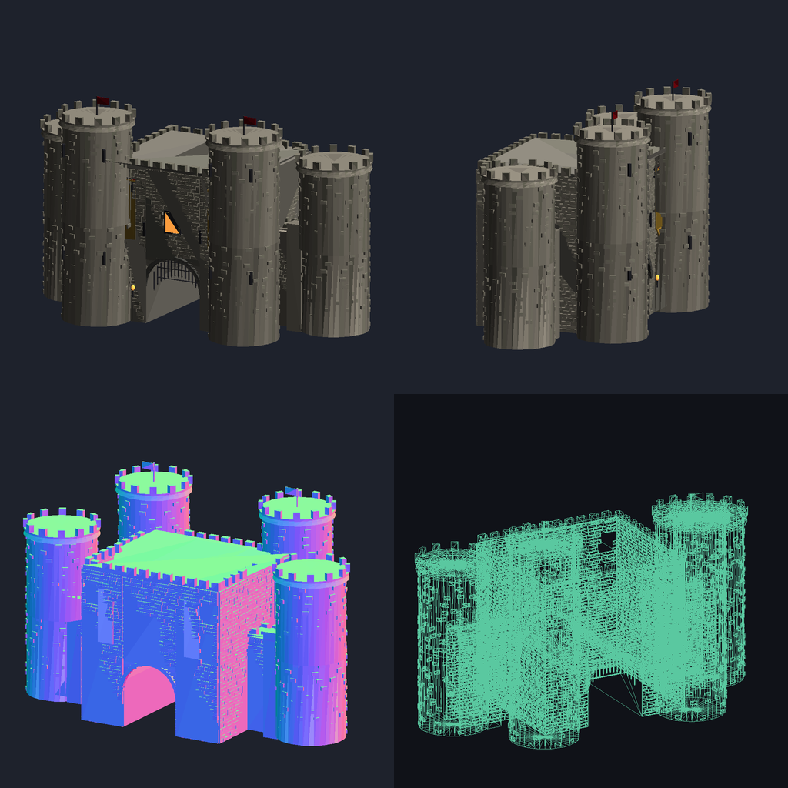
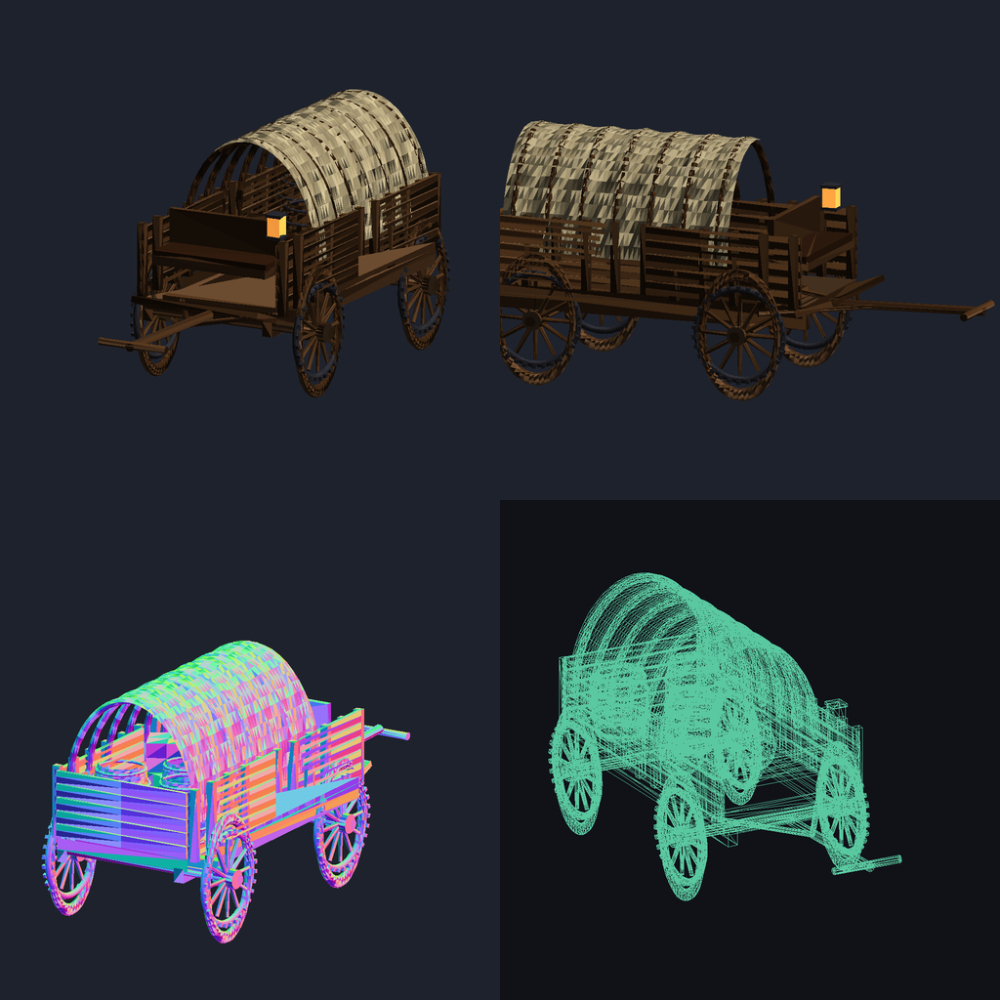
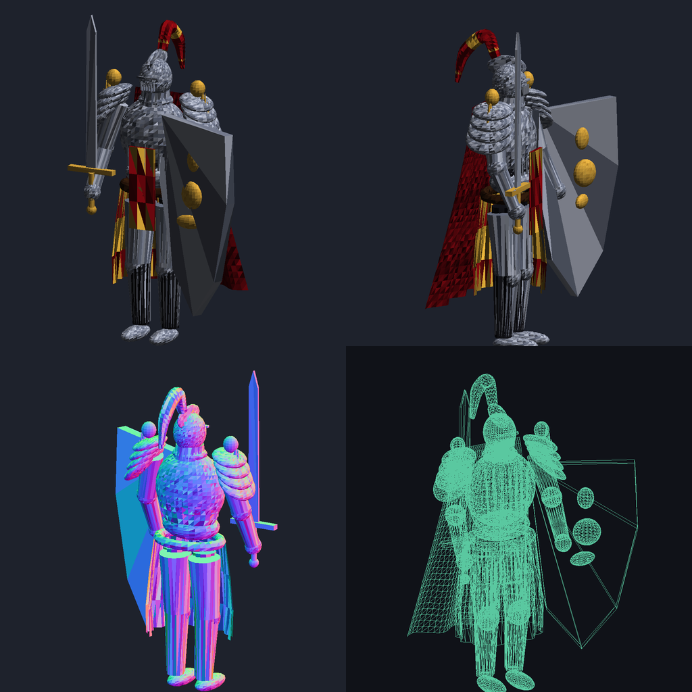
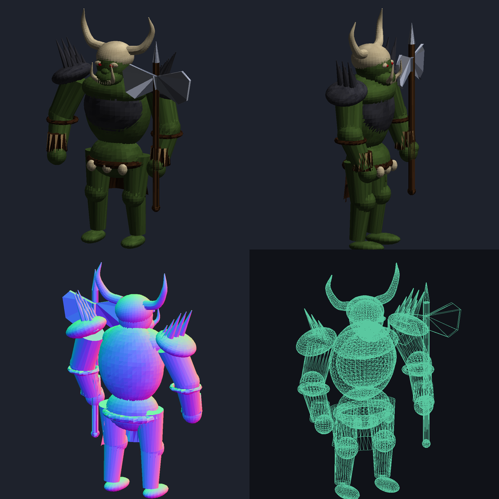
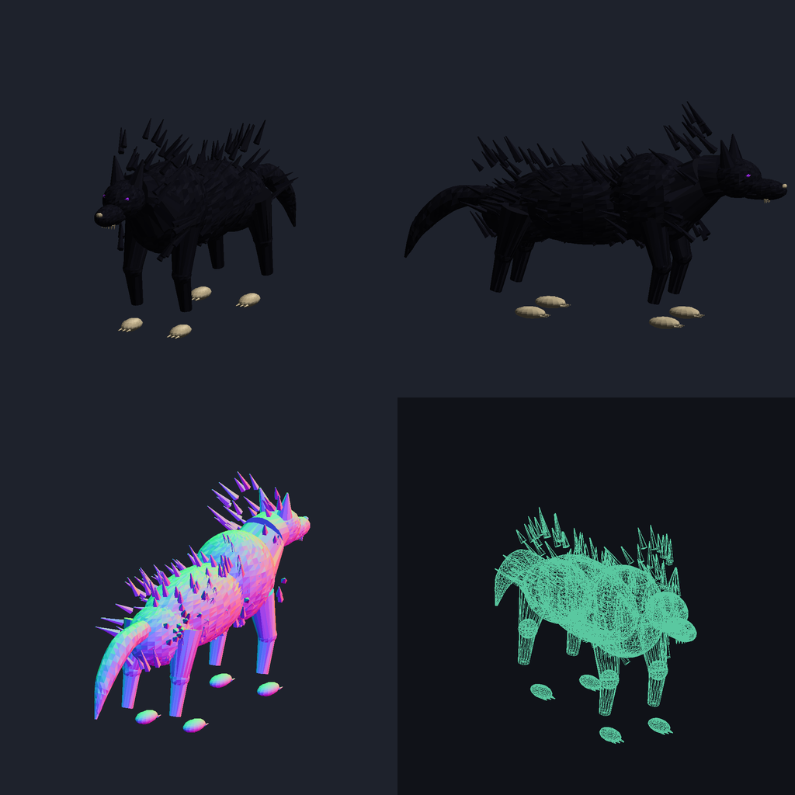
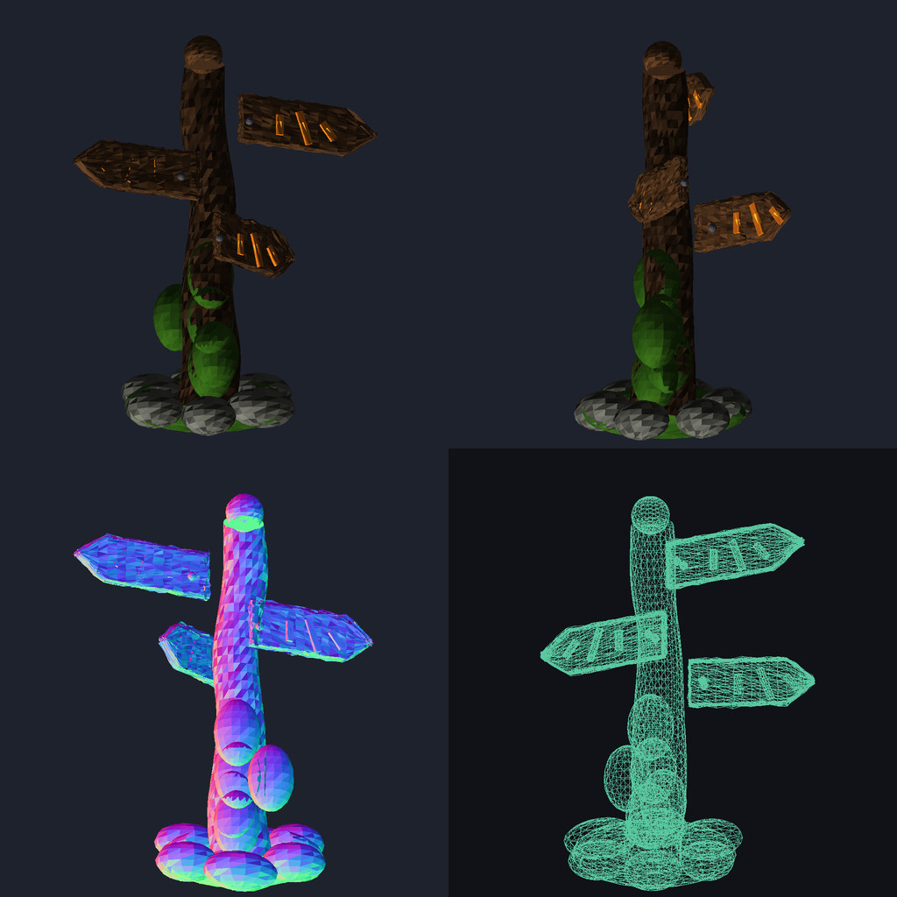
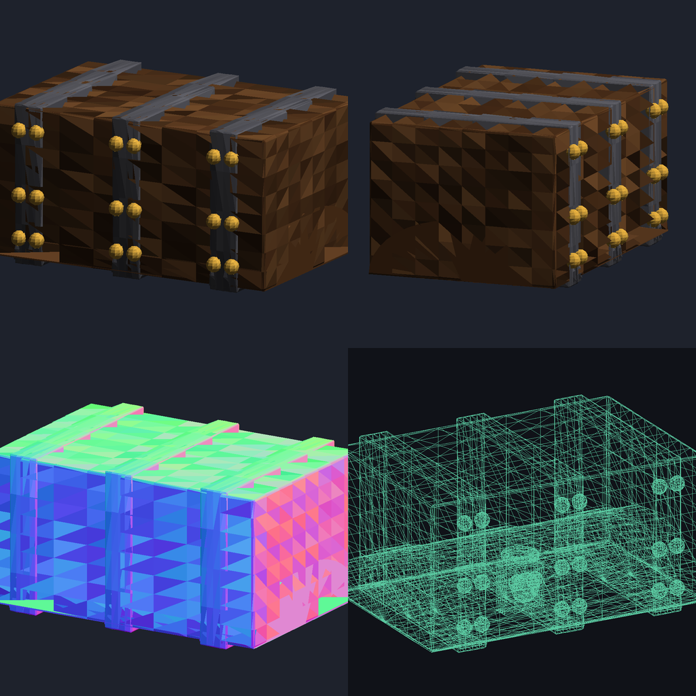
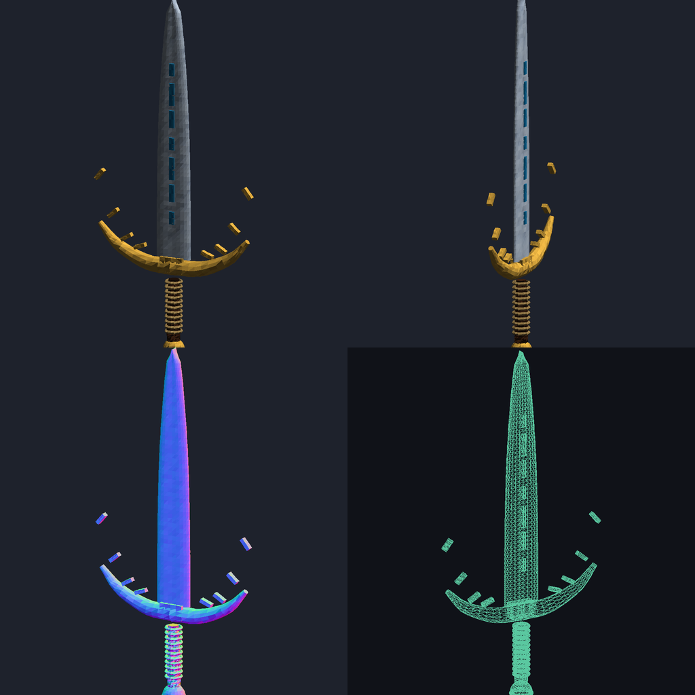

# Chronicles of Aetheria: Isekai

Native C++20 3D fantasy action-RPG, plus **vork_forge** — a token-efficient declarative Python DSL that compiles organic/architectural meshes with procedurally baked PBR textures straight to Blender-compatible `.glb`.

## Build & verify
    cmake -B build && cmake --build build -j4
    ./build/isekai --verify-headless      # loads every assets/models/**/*.glb, renders docs/previews/engine_headless_frame.png

## Asset pipeline
    pip install numpy pillow scikit-image
    python3 tools/assets/gen_<slug>.py            # -> assets/models/<cat>/<slug>.glb
    python3 tools/qa_asset.py assets/models/<cat>/<slug>.glb   # budget + PBR checks + 2x2 preview sheet

See `ASSET_CATALOG.md` and `ROADMAP_STATUS.md` for progress.

## Gallery (v0.3.0 — Valoria Kingdom Frontier)

## Controls
WASD move · Mouse look · LMB/F sword combo · RMB/Q Crimson Flare spell · Space roll/jump · Shift sprint
